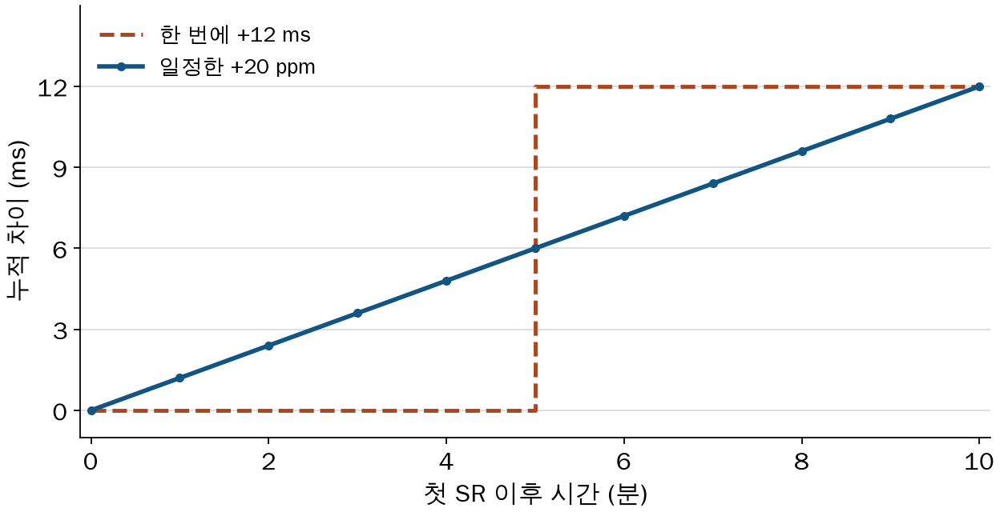

재생을 시작한 직후부터 소리가 화면보다 100 ms 늦고 한 시간 뒤에도 그대로라면, 같은 장면에서 소리가 처음엔 맞다가 한 시간 뒤에 100 ms 늦어지는 경우와 원인 후보가 다르다. 전자에서는 일정한 지연이나 시간축의 시작점을, 후자에서는 두 시계가 흐르는 속도와 재생 큐에 쌓이는 시간을 살펴볼 만하다.

이때 송신기 쪽 시간축을 볼 수 있는 패킷이 **RTCP Sender Report(SR)**다. 같은 송신원이 보낸 SR 두 개만 있어도 그 구간에서 미디어 시계가 송신기의 기준 시계보다 얼마나 빨리 갔는지 계산할 수 있다. 두 시계 중 어느 쪽이 UTC에서 벗어났는지까지 알려면 별도 기준이 필요하다. RTP 패킷 수신부터 프레임 복원까지의 흐름은 [RTSP 세션과 RTP frame 수신 경계 확인하기](/posts/embedded-system/protocol-security/onvif-rtsp-rtp-frame-boundary/)에서 다뤘다.

## 한 패킷에 찍힌 두 시각을 한 쌍으로 읽는다

SR의 송신자 정보에는 보고서를 보낸 시점의 **64비트 NTP 타임스탬프**와 그 **같은 순간**을 미디어 시계로 표현한 **32비트 RTP 타임스탬프**가 함께 들어 있다. 미디어 시계는 데이터 패킷과 같은 단위와 같은 시작점을 쓴다. 보고서를 보내는 순간에 샘플을 전송할 필요는 없어서, 바로 앞에 도착한 오디오 패킷의 RTP 값과 SR의 RTP 값은 달라도 정상이다. [RFC 3550 §6.4.1](https://www.rfc-editor.org/rfc/rfc3550.html#section-6.4.1)

Wireshark에서는 `rtcp.pt == 200`으로 SR이 포함된 패킷을 찾고, 해당 SR의 **Sender SSRC**, **NTP timestamp**, **RTP timestamp**를 한 행에 옮기면 된다. NTP의 정수부와 소수부를 각각 읽었다면 같은 NTP 시대(era) 안의 두 보고서는 `Δ정수부 + Δ소수부 / 2³²`초만큼 떨어져 있다. 캡처 화면에서 보이는 패킷 도착 시각은 따로 보관한다. 수신기의 시계와 네트워크 지연이 섞이는 값이기 때문이다. [Wireshark RTCP 필드](https://www.wireshark.org/docs/dfref/r/rtcp.html) · [RFC 3550 §4](https://www.rfc-editor.org/rfc/rfc3550.html#section-4)

RTP 숫자를 초로 바꾸려면 해당 페이로드의 clock rate가 필요하다. H.264 비디오의 90,000 Hz는 초당 타임스탬프가 90,000틱 증가한다는 뜻이다. 영상이 30 fps라면 명목상 한 프레임 간격은 3,000틱이다. 오디오에는 코덱별 속도를 적용한다. PCMU의 정적 페이로드 타입 0은 8,000 Hz를 쓰고, 동적 페이로드 타입은 트랙의 SDP 매핑부터 확인한다. [RFC 6184 §5.1](https://www.rfc-editor.org/rfc/rfc6184.html#section-5.1) · [RFC 3551 §6](https://www.rfc-editor.org/rfc/rfc3551.html#section-6)

## 첫 보고서를 기준으로 오차의 기울기를 구한다

같은 SSRC에서 연속된 구간을 고른다. 첫 SR 이후 NTP 기준으로 지난 시간을 `ΔN`초, RTP 시계가 진행한 양을 `ΔR`틱, 명목 clock rate를 `f`틱/초라고 두자.

```text
미디어 경과 시간 = ΔR / f
누적 차이(초)    = ΔR / f − ΔN
상대 속도(ppm)   = (ΔR / f − ΔN) / ΔN × 1,000,000
```

이 부호 정의에서 **+20 ppm**이면 NTP 시계로 1초가 흐르는 동안 RTP 시계가 명목 속도보다 20 µs 더 진행했다. 10분이면 12 ms, 한 시간이면 72 ms가 쌓인다. 여기서 ppm은 관측 구간의 **평균 상대 속도 오차**다. 짧은 구간에서 한 번 구한 값이 재생 내내 유지되는지는 여러 SR로 확인한다.

고정 오프셋은 이 식을 통과하면 사라진다. 예를 들어 송신기의 NTP 시각이 독립 기준보다 매번 100 ms 앞서 있어도 두 NTP 값의 차이에서는 100 ms가 상쇄된다. RTP의 초기 타임스탬프도 임의의 값에서 시작한다. 첫 SR에서 오차가 0인 것은 그 점을 원점으로 잡았기 때문이다. 처음부터 소리와 화면이 맞았는지는 같은 장면의 출력 시각으로, 송신기 시계가 UTC에 맞았는지는 독립된 기준 시계로 확인한다. [RFC 3550 §5.1](https://www.rfc-editor.org/rfc/rfc3550.html#section-5.1)

## 32비트 경계를 지나는 예제

다음은 90 kHz 스트림에서 SR 세 개를 골랐다고 가정한 **합성 데이터**다. `ntp_s`는 첫 SR 이후 흐른 초, `rtp32`는 패킷에 담기는 32비트 값이다. 첫 값은 카운터 끝에 가깝고 두 번째 값은 한 바퀴 돈 뒤라 더 작다. 인접 SR 간에 시계가 순방향으로 한 바퀴 미만 진행했다는 조건에서 `(현재값 - 직전값) % 2**32`로 실제 증가량을 구할 수 있다.

```python
from math import isclose

rate = 90_000
reports = [
    # ntp_s, rtp32
    (0,   4_294_958_296),
    (300,    26_991_540),
    (600,    53_992_080),
]

elapsed_ticks = 0
for (prev_ntp, prev_rtp), (ntp_s, rtp32) in zip(reports, reports[1:]):
    assert ntp_s > prev_ntp
    elapsed_ticks += (rtp32 - prev_rtp) % (2**32)
    elapsed_s = ntp_s - reports[0][0]
    error_s = elapsed_ticks / rate - elapsed_s
    ppm = error_s / elapsed_s * 1_000_000
    print(f"{elapsed_s:3d} s  {error_s * 1000:+.1f} ms  {ppm:+.1f} ppm")

assert elapsed_ticks == 54_001_080
assert isclose(ppm, 20.0, abs_tol=1e-6)
```

```text
300 s  +6.0 ms  +20.0 ppm
600 s  +12.0 ms  +20.0 ppm
```

600초 동안의 명목 증가량은 54,000,000틱이다. 예제에서는 1,080틱이 더 진행했고 이는 정확히 12 ms다. 90 kHz에서 32비트 한 바퀴는 약 13시간 15분이 걸린다. 그보다 캡처 공백이 길면 전후 두 값만으로 몇 바퀴 돌았는지 복원할 수 없다. 공백이 짧아도 송신기 재시작·패킷 순서 역전이 의심되면 구간을 끊어야 한다. 재시작 직후의 작은 값에도 모듈러 연산은 그럴듯한 큰 양수를 내준다. clock rate 변경 전후도 각각 계산한다. [RFC 7160 §4](https://www.rfc-editor.org/rfc/rfc7160.html#section-4)

## 오차가 직선인가, 특정 시점에 튀는가

실제 캡처에서는 가로축에 첫 SR 이후 NTP 경과 시간, 세로축에 `ΔR / f − ΔN`을 놓고 점을 찍는다. 시작과 끝 두 점으로 낸 ppm이 같아도 중간 점의 모양은 다를 수 있다.



그림에서 두 경우 모두 첫 SR과 마지막 SR로 계산하면 +20 ppm이다. 중간 SR을 보면 실선은 매분 1.2 ms씩 벌어지고, 점선은 5분 지점에서 한 번 12 ms 변한 뒤 평평하다. 점선에 10분 평균만 적용하면 시각이 한 번 바뀐 일을 지속적인 속도 오차로 해석하게 된다.

| 관측 | 해석할 때 볼 것 |
| --- | --- |
| 외부 기준과 비교한 시각 차이는 거의 일정하고, SR 누적 차이도 평평하다 | 고정 오프셋이 있는지 본다. 절대 오프셋은 동일 사건을 기록한 독립 기준과 비교해야 한다. |
| SR 누적 차이가 시간에 비례해 증가한다 | 그 구간에서 RTP가 송신기 기준 시계보다 빠르다. 어떤 시계의 주파수가 달라졌는지는 별도 계측이 필요하다. |
| SR 누적 차이가 한 번에 아래로 이동하고 이후 기울기가 원래대로 돌아온다 | RTP가 연속이었다면 기준 시각이 앞으로 뛰었을 때와 맞는다. 시각 보정·재시작 시점과 대조한다. |
| SR 누적 차이는 평평한데 화면이 점점 늦어진다 | 송신기 SR에서는 속도 차이를 찾기 어렵다. 프레임의 큐 체류 시간과 수신기 재생 버퍼를 측정한다. |

시각을 서서히 보정하는 slew는 그 시간 동안 기울기로 보일 수 있다. 일정 구간을 골라 직선을 맞추고 각 점이 직선에서 얼마나 벗어나는지 본 뒤, 보정 전·중·후의 기울기를 따로 비교하면 순간 점프를 장시간 드리프트로 잘못 읽는 일을 줄일 수 있다. 송신기가 두 SR 필드를 같은 소프트웨어 시계에서 계산하면 그 둘은 잘 맞으면서도 실제 오디오 샘플은 조금씩 벗어날 수 있다. 이런 경우에는 RTP 데이터의 샘플 진행량이나 독립적으로 시각을 잰 입력 신호까지 대조해야 한다.

오디오와 영상의 립싱크를 볼 때는 트랙마다 자신의 SR 쌍으로 RTP를 공통 기준 시각에 대응시킨다. 두 트랙은 초기 RTP 값과 clock rate가 서로 다를 수 있다. 같은 박수의 영상·음성처럼 대응되는 사건에 대해 환산 시각과 실제 출력 시각을 각각 비교하면 송신 타임스탬프의 어긋남과 재생 단계 지연을 좁힐 수 있다. 예를 들어 패킷의 언랩된 RTP 값 R이 두 SR 값 R₁과 R₂ 사이에 있으면, 같은 구간에서 시계가 일정하게 진행한다는 가정 아래 기준 시각을 다음처럼 보간할 수 있다.

```text
추정 시각 = N₁ + (R − R₁) × (N₂ − N₁) / (R₂ − R₁)
```

이 계산을 트랙별로 한 뒤 두 결과를 비교한다. SR 쌍은 같은 시계 구간에서 골라야 하고 두 트랙의 NTP 필드도 공통 기준을 써야 한다. RFC는 절대 시각을 모르는 송신기가 상대 NTP 값을 사용하는 경우도 허용한다. [RFC 3550 §5.1·§6.4.1](https://www.rfc-editor.org/rfc/rfc3550.html#section-6.4.1)

## 75분 오디오 관측에서 확인한 범위

11월 12일에 남긴 장비 시험 기록에는 영상 입력 없이 오디오 스트림만 75분간 받은 결과가 있다. 이 구간에서 SR의 RTP 시각과 오디오 데이터 시각 사이에는 문제로 보던 누적 어긋남이 나타나지 않았다. 같은 시간 동안 송신기 시스템 시각에도 NTP 보정이 관측되지 않았다. 앞의 90 kHz 예제와 +20 ppm은 계산을 보여 주기 위해 따로 만든 값이다.

보정 직후의 립싱크까지 보려면 시각 보정 전후의 SR과 같은 구간의 오디오·영상 RTP를 함께 기록해야 한다. 같은 박수 소리와 손뼉이 맞닿는 장면을 독립된 시계로 기록해 두면, 송신 시각과 실제 재생 시각 중 어디서 차이가 생겼는지 비교할 수 있다.
